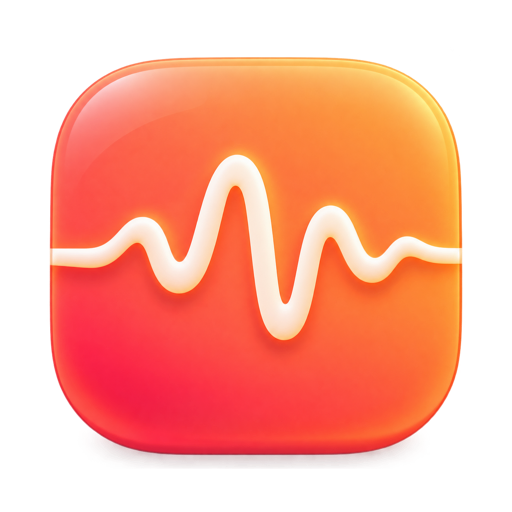

<p align="center">
  
</p>

<h1 align="center">Mumble</h1>

<p align="center">
  Fast, accurate, fully on-device dictation for the Mac.<br>
  Hold a key, speak, release: the text appears wherever your cursor is.
</p>

---

Speech recognition runs on the Apple Neural Engine via
[FluidAudio](https://github.com/FluidInference/FluidAudio) (NVIDIA Parakeet-family models).
Audio and text never leave your Mac.

See [prd.md](prd.md) for the product spec.

## Install

Requires a Mac with Apple silicon (M1 or later) and macOS 15 or later.

```sh
curl -fsSL https://raw.githubusercontent.com/dahal/mumble/main/scripts/install.sh | bash
```

That downloads the latest release, verifies its SHA-256 checksum and code signature, installs Mumble
to `/Applications` and opens it. Run the same command to update. Options:
`MUMBLE_VERSION=0.2.0` for a specific version, `MUMBLE_UNINSTALL=1` to remove it.

Prefer clicking? Download the `.dmg` from [Releases](https://github.com/dahal/mumble/releases) and drag
Mumble to Applications. If the release isn't notarized, the first open shows "Apple could not verify
Mumble"; go to System Settings → Privacy & Security and click **Open Anyway** once.

## Build from source

```sh
brew install xcodegen          # once
scripts/build.sh               # → build/Mumble.app
open build/Mumble.app
```

On first launch Mumble opens its settings window:

1. **Microphone**: click *Grant…*.
2. **Accessibility**: click *Grant…*, then turn Mumble on in System Settings → Privacy & Security →
   Accessibility. This is how Mumble hears the shortcut and pastes text.
3. **Speech model**: downloads once (~330 MB for the default Phonon-2) and is cached in
   `~/Library/Application Support/FluidAudio`.

Then, in any app:

| Action | Result |
|---|---|
| Hold **Right ⌥ Option**, speak, release | Text is inserted at the cursor |
| Double-tap Right ⌥, speak, press it once more | Hands-free (locked) dictation |
| **Esc** while recording | Cancel |
| Menu bar → *Paste last again* | Re-insert the last dictation |

The trigger key can be changed to fn, Right ⌘ or Right ⌃ in settings. If you choose fn, set
System Settings → Keyboard → "Press 🌐 key to" → "Do Nothing" so it doesn't also open the emoji picker.

> **Signing:** `scripts/build.sh` signs with a local self-signed identity it creates in `.signing/`
> (its own keychain file, never added to your login keychain). The signature is stable, so Microphone
> and Accessibility permissions survive rebuilds.

**Microphone:** *Automatic* (the default) records from your system microphone, but if that's a
Bluetooth headset it uses the built-in mic instead: opening a Bluetooth mic switches the headphones
to the hands-free call profile (16 kHz, audibly worse music) and costs accuracy. You can still choose
the headset mic explicitly in settings.

**Logs:** `~/Library/Logs/Mumble/Mumble.log` (menu bar → Show Log). Timings and device names only,
never transcript text. Crash reports, if any, are in `~/Library/Logs/DiagnosticReports/Mumble-*.ips`.

## Features

- **Notch island**: a Dynamic Island–style pill grows out of the notch, showing the input level, a
  timer and the live transcript. On displays without a notch it floats below the menu bar.
- **Two-pass recognition**: a live preview every ~450 ms, then one final pass on release
  (~30–50 ms for a typical sentence on an M2 Max).
- **Custom vocabulary** with aliases: CTC keyword boosting, plus safeguards that reject any swap
  that drops words or replaces real dictionary words (see `Vocabulary.guardRescore`).
- **Text clean-up**: filler-word removal, "new line" / "new paragraph", user replacement rules,
  cursor-aware spacing and capitalization. Writing numbers as digits is opt-in (experimental).
- **Never loses text**: the clipboard is restored after pasting; secure (password) fields get a
  copy instead of a paste; history is kept locally and can be turned off.
- **Model choice**: Phonon-2 (default), Parakeet Ultra (multilingual, most accurate), TDT v3/v2,
  and a light 110M model. See [Languages](#languages).
- **Meeting notes**: who said what, by name, plus a summary and action items. See
  [Meeting notes](#meeting-notes).

## Meeting notes

Take notes on Google Meet, Zoom, Teams or Slack calls, with **who said what, by name**, and
notes written for you. No bot joins the call and nothing leaves your Mac.

- **Start**: press **⌥⇧M**, choose *Start Meeting Notes* in the menu bar, or click **Take Notes**
  when Mumble notices a call starting (an island prompt and a notification). An optional
  heads-up appears 1 minute before calendar meetings.
- **Two clean tracks**: your microphone is always *you*; the meeting app's own audio (a Core Audio
  process tap, macOS 14.4+) is everyone else. Speaker echo from laptop speakers is removed so it
  isn't transcribed twice.
- **Who said what**: the others are separated by speaker diarization (FluidAudio, on the Neural
  Engine). Name a voice once with **Choose name…**; with *Remember voices* on, Mumble recognizes
  that person automatically next time. Calendar invites (from the calendars on your Mac, no
  Google sign-in) suggest names; live captions can be read too (experimental).
- **Notes**: summary, decisions, action items with owners and open questions. They're written on
  your Mac with Apple Intelligence when it's on, otherwise by Mumble's built-in extractor. Claude is
  an opt-in alternative (your API key; only transcript text is sent, never audio).
- **During the call**: the island shows the live transcript and who's talking; **⌥⇧B** bookmarks the
  moment; optionally, dictation becomes a private note instead of pasting.
- **Afterwards**: search every meeting, check off action items, copy as Markdown, or keep a
  Markdown copy in a folder you choose (e.g. an Obsidian vault). Notes are stored in a local SQLite
  database; meeting audio is deleted after processing unless you choose to keep it.
- **Permissions** are asked only when needed: System Audio Recording (other people's audio),
  Calendars (optional), Screen Recording (optional, to read names from the meeting window).

Recording-consent laws differ by place; Mumble offers a one-click message to tell everyone you're
taking notes. Details: [`docs/specs/meeting-notes.md`](docs/specs/meeting-notes.md).

## Languages

The default model, **Phonon-2, is English-only.** For any other language, pick **Parakeet Ultra**
(or Parakeet TDT v3) in **Settings → General → Speech model**. Both detect the language
automatically, so you can switch languages between dictations without changing anything.

| Language | Code | Model to pick | Typical accuracy* |
|---|---|---|---|
| English | en | Phonon-2 (default) or any model | ~5% WER |
| Bulgarian | bg | Parakeet Ultra / TDT v3 | ~13% WER |
| Croatian | hr | Parakeet Ultra / TDT v3 | ~12% WER |
| Czech | cs | Parakeet Ultra / TDT v3 | ~11% WER |
| Danish | da | Parakeet Ultra / TDT v3 | ~18% WER |
| Dutch | nl | Parakeet Ultra / TDT v3 | ~7% WER |
| Estonian | et | Parakeet Ultra / TDT v3 | ~18% WER |
| Finnish | fi | Parakeet Ultra / TDT v3 | ~13% WER |
| French | fr | Parakeet Ultra / TDT v3 | ~5% WER |
| German | de | Parakeet Ultra / TDT v3 | ~5% WER |
| Greek | el | Parakeet Ultra / TDT v3 | ~21% WER |
| Hungarian | hu | Parakeet Ultra / TDT v3 | ~16% WER |
| Italian | it | Parakeet Ultra / TDT v3 | ~3% WER |
| Latvian | lv | Parakeet Ultra / TDT v3 | ~23% WER |
| Lithuanian | lt | Parakeet Ultra / TDT v3 | ~20% WER |
| Maltese | mt | Parakeet Ultra / TDT v3 | ~20% WER |
| Polish | pl | Parakeet Ultra / TDT v3 | ~7% WER |
| Portuguese | pt | Parakeet Ultra / TDT v3 | ~5% WER |
| Romanian | ro | Parakeet Ultra / TDT v3 | ~12% WER |
| Russian | ru | Parakeet Ultra / TDT v3 | ~6% WER |
| Slovak | sk | Parakeet Ultra / TDT v3 | ~9% WER |
| Slovenian | sl | Parakeet Ultra / TDT v3 | ~24% WER |
| Spanish | es | Parakeet Ultra / TDT v3 | ~3% WER |
| Swedish | sv | Parakeet Ultra / TDT v3 | ~15% WER |
| Ukrainian | uk | Parakeet Ultra / TDT v3 | ~7% WER |

\* Word error rate of Parakeet TDT v3 on the FLEURS benchmark, from
[NVIDIA's model card](https://huggingface.co/nvidia/parakeet-tdt-0.6b-v3) (lower is better; Ultra is
slightly more accurate overall). Treat these as a guide: lower-accuracy languages work, but expect
more corrections.

The models in **Settings → General → Speech model**:

| Model | Languages | Download | Best for |
|---|---|---|---|
| Phonon-2 · Balanced (default) | English | ~330 MB | English dictation: small, fast, very accurate |
| Parakeet Ultra · Max | 25 above | ~620 MB | Multilingual, and the most accurate overall |
| Parakeet TDT v3 · Classic | 25 above | ~480 MB | Multilingual, smaller than Ultra |
| Parakeet TDT v2 · Classic | English | ~480 MB | English, strong recall |
| Parakeet 110M · Light | English | ~230 MB | Lightest and fastest; slightly less accurate |

All models run on the Neural Engine at similar speed (a typical sentence takes 35–65 ms) and are
downloaded once when selected.

Not supported yet: Japanese, Chinese, Korean, Arabic, Hindi and other languages outside the list
above. Their speech is transcribed as English-sounding gibberish. (FluidAudio has models for these,
such as SenseVoice, but Mumble doesn't integrate them yet.)

Some text features are English-only: filler-word removal (*um*, *uh*), spoken commands
("new line", "new paragraph") and custom-vocabulary boosting. In other languages they simply have
no effect. Writing numbers as digits (experimental, off by default) supports English, German,
Spanish, French, Hindi, Japanese and Chinese.

## Releasing

Releases are automatic. **Every pull request merged into `main` that changes the app publishes a
new version.** There's nothing to tag by hand.

Versions follow [Semantic Versioning](https://semver.org), decided by the PR title (PRs are
squash-merged, so the title becomes the commit message on `main`). A check on every PR enforces
[Conventional Commits](https://www.conventionalcommits.org) titles:

| PR title | Release |
|---|---|
| `fix: paste fails in Terminal` (also `perf:`, `refactor:`, `chore:` …) | patch: 0.1.1 → 0.1.2 |
| `feat: Apple Speech fallback` / `feat(audio): …` | minor: 0.1.1 → 0.2.0 |
| `feat!: new settings format` (`!` = breaking) | major; minor while below 1.0 |

- Merges that only touch docs, design files or CI don't release. Add `[skip release]` to a PR
  title to skip one.
- Manual releases still work: run **Release** from the Actions tab (choose patch/minor/major or an
  exact version), or push a tag yourself (`git tag v1.2.0 && git push origin v1.2.0`). A suffix
  like `v1.3.0-beta.1` publishes a pre-release, which the installer ignores.
- `scripts/next-version.sh` prints the version the next release would get;
  `scripts/test-next-version.sh` tests it.

Each release runs the unit tests, builds with the new version, signs, packages
`Mumble-<version>.dmg`, `Mumble-<version>.zip`, `Mumble.zip` and `SHA256SUMS.txt`, and publishes a
GitHub release with the tag, install instructions and the list of merged PRs.
`.github/workflows/ci.yml` runs the tests and a build on every push and pull request.

Repository settings this relies on: squash merging only, with the PR title as the commit message.

Signing, via repository secrets:

| Secret | Effect |
|---|---|
| *(none)* | Self-signed with a fresh identity per release. Works; users re-grant permissions after each update. |
| `MUMBLE_SIGNING_P12_BASE64` | Self-signed with a stable identity, so permissions survive updates. Set it with `scripts/export-signing-identity.sh \| gh secret set MUMBLE_SIGNING_P12_BASE64`. |
| `DEVELOPER_ID_P12_BASE64`, `DEVELOPER_ID_P12_PASSWORD` | Signed with your Apple Developer ID (requires the $99/year Apple Developer Program). |
| `NOTARY_KEY_ID`, `NOTARY_ISSUER_ID`, `NOTARY_KEY_BASE64` | With Developer ID: notarized and stapled, so a downloaded `.dmg` opens with no warning. Uses an App Store Connect API key (`.p8`, base64). |

Locally, `scripts/build.sh` then `scripts/package.sh` produce the same artifacts in `build/dist/`.

## Layout

```
Packages/MumbleKit/          Swift package
  Sources/MumbleCore/        pure logic: text pipeline, vocabulary, hotkey gesture, WER, audio analysis
  Sources/MumbleASR/         FluidAudio wrapper (TranscriptionEngine), audio file loading
  Sources/MumbleEval/        mumble-eval CLI
  Tests/                     unit tests + model integration tests
Mumble/                      the macOS app (menu bar, island, hotkey, recorder, inserter, settings)
Eval/make-tts-corpus.sh      builds a synthetic eval set with macOS voices
scripts/build.sh             builds and signs build/Mumble.app (MUMBLE_VERSION, MUMBLE_BUILD)
scripts/sign.sh              Developer ID or stable self-signed signing, hardened runtime
scripts/package.sh           dmg + zip + checksums in build/dist (notarizes when configured)
scripts/install.sh           the curl | bash installer users run
scripts/next-version.sh      next SemVer version from commit messages (+ test-next-version.sh)
.github/workflows/           CI and release
scripts/make-icon.sh         updates Mumble/AppIcon.icon (Icon Composer) from artwork
project.yml                  XcodeGen project definition
```

## Test

```sh
cd Packages/MumbleKit
export DEVELOPER_DIR=/Applications/Xcode.app/Contents/Developer
swift test                               # unit tests (fast, no model)
MUMBLE_INTEGRATION=1 swift test          # + real-model tests (downloads the model on first run)
```

Accuracy and speed:

```sh
Eval/make-tts-corpus.sh                                   # or add your own .wav + .txt pairs
swift run -c release mumble-eval ../../Eval/tts           # WER + real-time factor
swift run -c release mumble-eval <dir> --model ultra --vocab "kubectl,Supabase"
```

App-level checks without touching the keyboard:

```sh
build/Mumble.app/Contents/MacOS/Mumble --self-test some.wav     # full pipeline on a file
build/Mumble.app/Contents/MacOS/Mumble --demo-island            # animate the island on screen
build/Mumble.app/Contents/MacOS/Mumble --render-island /tmp/x   # island states → PNGs
```

Acoustic end-to-end test against a real app (quit other Mumble instances first; uses the MacBook
speakers even when headphones are connected; don't type while it runs):

```sh
open -n -W build/Mumble.app --args --e2e /tmp/e2e.txt --file "$PWD/test.md" [--mic "Nothing"]
cat /tmp/e2e.txt
```

It opens the file in VS Code, presses Right ⌥ with real key events, speaks with `say`, saves and
reads the file back. Before every synthetic key press it verifies VS Code with that file is
frontmost, and it only allows pastes into VS Code, so it can never type into another app.
Scenarios: hold ×3 back to back, double-tap latch, Esc cancel, ~30 s dictation, cold mic start.
It also records the output device's sample rate to prove Bluetooth audio isn't degraded.

Meeting notes end to end (plays synthetic voices aloud for ~3 minutes; uses a temporary database
and restores your settings; types nothing):

```sh
open -n -W build/Mumble.app --args --e2e-meeting /tmp/e2e-meeting.txt
cat /tmp/e2e-meeting.txt
```

Two participants play from an `afplay` process that Mumble records with a real process tap; "you"
play through the built-in speakers so the real microphone hears you (and the echo of the
others). It checks the transcript, speaker separation, echo removal, notes and owners,
bookmarks, naming, automatic recognition from saved voices in a second meeting, search, the
Markdown copy, catch-the-start and Not Now.

## Measured (M2 Max, Phonon-2)

| | Result |
|---|---|
| End-to-end in VS Code (speakers → mic → paste), 7 scenarios | 7/7 pass, 0% WER on sentences |
| Key release → text pasted | 50–90 ms for a sentence; ~260 ms for 23 s of speech |
| Bluetooth headphones as output while dictating | stays at 44.1 kHz (no call-profile switch) |
| Idle | 0% CPU, ~170 MB with the model loaded |
| Synthetic dictation set (10 sentences) | 0% WER, ~30 ms per sentence, ~90× real-time |
| Jargon set (names, dev tools) without vocabulary | 23.8% WER |
| Same, with vocabulary | 9.5% WER, and still 0% on the plain set (no false swaps) |
| App bundle | 6.9 MB (models downloaded separately) |

The test sets are synthetic speech from `say`, so treat these as smoke tests. Real recorded dictation
belongs in `Eval/` before claiming accuracy numbers.

## License

Mumble is free software, licensed under the [GNU Affero General Public License v3.0](LICENSE)
(AGPL-3.0-only). You may use, study, modify and share it; if you distribute a modified version, or
let others use one over a network, you must make your source code available under the same license.

Third-party components:

- [FluidAudio](https://github.com/FluidInference/FluidAudio) (Apache-2.0), including its NeMo text
  normalization library. Apache-2.0 code may be combined into AGPL-3.0 software.
- Speech models are not bundled. They are downloaded on first use from
  [FluidInference on Hugging Face](https://huggingface.co/FluidInference) under their own licenses
  (see each model card).
